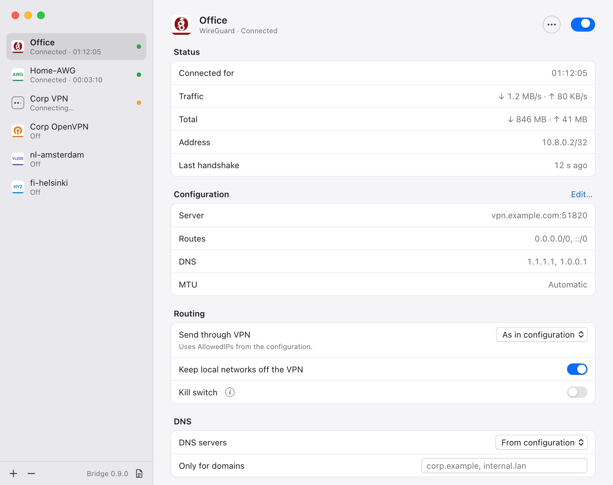

Bridge 0.9.0 is a redesign of the whole interface, plus Russian and German. The VPN engine is unchanged.

**Download `Bridge-0.9.0.dmg`** below. `Bridge.zip` is for the built-in updater of earlier versions.



## Install

Bridge is free and not notarized by Apple, so macOS warns the first time. The disk image has an installer script that copies Bridge into Applications and removes the quarantine flag:

1. Open `Bridge-0.9.0.dmg`.
2. In Terminal, run:
   ```bash
   bash "/Volumes/Bridge 0.9.0/Install Bridge.command"
   ```
3. Click the **VPN** icon in the menu bar → **Install Network Helper…** (one password prompt).

By hand instead: drag Bridge into Applications, then run `xattr -dr com.apple.quarantine /Applications/Bridge.app`, or open it once and allow it in **System Settings → Privacy & Security → Open Anyway**.

Updating from 0.6.x: use **Update to Bridge 0.9.0…** in the menu, then update the helper when asked.

## What's new

**Menu**
- Status on top, then a coloured block for anything you need to act on (kill switch, helper, update), then the tunnels.
- Each tunnel shows a status dot; connected ones show uptime, speed and address underneath.
- Clicking a tunnel without the helper offers to install it and connect.
- New **Settings… (⌘,)**; About is gone, its licenses moved to Settings → Advanced.

**Manage Tunnels**
- Settings apply as you change them — no Save button. A banner offers **Reconnect** when a connected tunnel needs it.
- Errors appear under the field that caused them; invalid values aren't saved.
- Sidebar shows each tunnel's state and uptime, and the app version.
- Live status is separate from the configuration; the kill switch is explained in a popover.
- The config editor checks the file as you type. Drop `.conf` / `.ovpn` files on the window to import them.

**Adding tunnels**
- Links show a preview of the tunnels that will be added and which lines are skipped. The clipboard is no longer read on its own.

**Sign-in**
- One dialog layout for every login; **Connect** stays disabled until required fields are filled.
- An untrusted certificate defaults to **Cancel**; the SSO window shows the domain of the sign-in page.

**Also**
- New Settings window: open at login, speed in the menu, automatic updates, helper status, tunnels folder, logs, routing profiles.
- A tunnel that drops in the background now posts a notification.
- English, Russian and German, following the system language.

[Screen-by-screen design](https://github.com/rtmo0/vpn-tunnel-bridge/tree/main/docs/design)

---

## Bridge 0.9.0 — по-русски

Полностью переработанный интерфейс, русский и немецкий языки. VPN-движок не менялся.

**Скачайте `Bridge-0.9.0.dmg`** ниже (`Bridge.zip` нужен встроенному обновлению старых версий).

**Установка.** Bridge бесплатный и не нотаризован Apple, поэтому macOS предупреждает при первом запуске. Откройте DMG и выполните в Терминале:

```bash
bash "/Volumes/Bridge 0.9.0/Install Bridge.command"
```

Скрипт скопирует Bridge в «Программы», снимет флаг карантина и запустит его. Затем значок **VPN** в строке меню → **Установить сетевой помощник…**.

**Главное:**
- Меню: сначала состояние, затем цветной блок действий (kill switch, помощник, обновление), затем туннели с точкой состояния, временем, скоростью и адресом.
- Окно туннелей: настройки применяются сразу, без кнопки «Сохранить»; плашка «Переподключить», когда это нужно; ошибки — под полем.
- Новое окно «Настройки» (⌘,): автозапуск, обновления, помощник, журналы, профили маршрутизации, лицензии.
- Единый диалог входа, предпросмотр при добавлении ссылок, уведомление об обрыве туннеля.
- Интерфейс на английском, русском и немецком — по языку системы.
